# Windows 11 Help Desk Lab

I built this lab to practice the kind of tickets a help desk sees every day: setting up new accounts, handing out temporary admin rights, unlocking someone who typed their password wrong too many times, digging through the security log, locking down a team folder, and onboarding a batch of new hires with a script instead of clicking through the same screens six times.

Each section starts with the ticket as I'd expect to get it, then what I did and how I checked that it actually worked. Everything was run in PowerShell as an administrator. If you want a plain-English rundown of every command I used, that's in [windows-command-reference.md](windows-command-reference.md).

All the accounts here are test accounts, and I blacked out my public IP addresses in the screenshots.

## Setup

| Item | Value |
| --- | --- |
| Host | Mac mini (Apple silicon), running UTM |
| Guest | Windows 11 Pro 25H2 (arm64) |
| Network | Bridged, so the VM gets its own address on my home network |

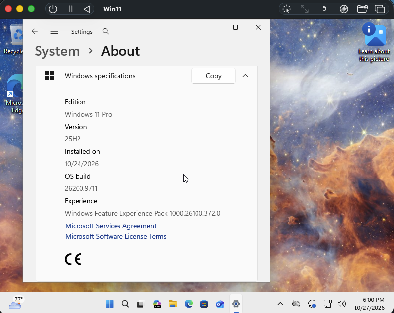

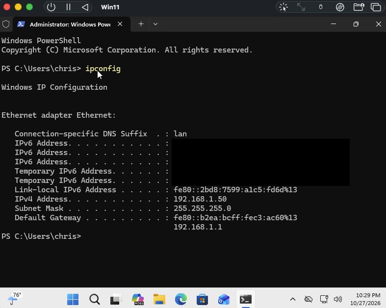

## 1. New user accounts

> **Ticket:** New employee John Appleseed needs a standard account. A contractor also needs temporary admin rights to install some software.

I made both accounts in Local Users and Groups (`lusrmgr.msc`). John got a standard account. For the contractor I made `testadmin`, added it to the Administrators group, and put "Temporary Admin for a software install" in the description so whoever looks at it next knows it isn't supposed to stick around.

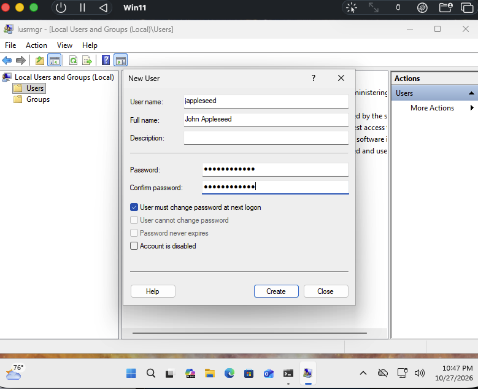

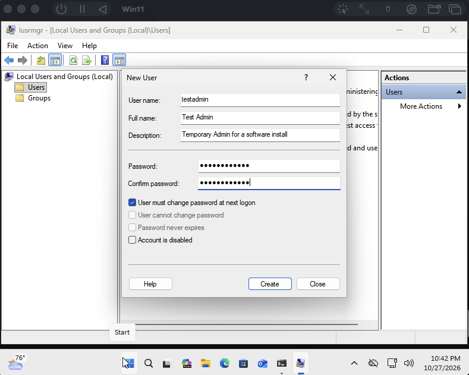

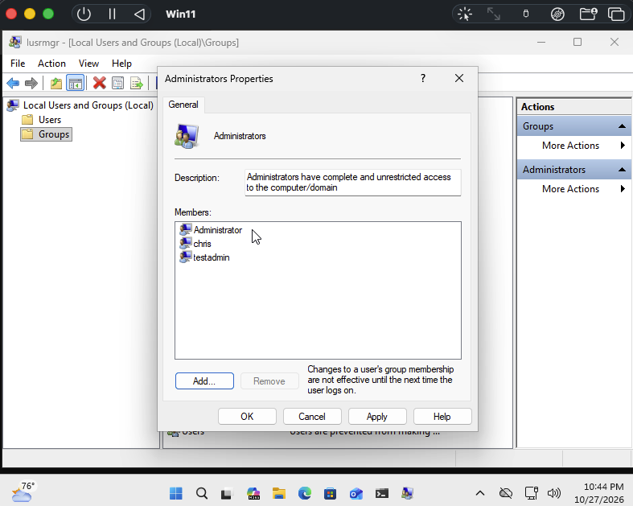

Then I double-checked from PowerShell instead of just trusting the GUI:

```powershell
Get-LocalUser
Get-LocalGroupMember -Group "Administrators"
Get-LocalGroupMember -Group "Users"
```

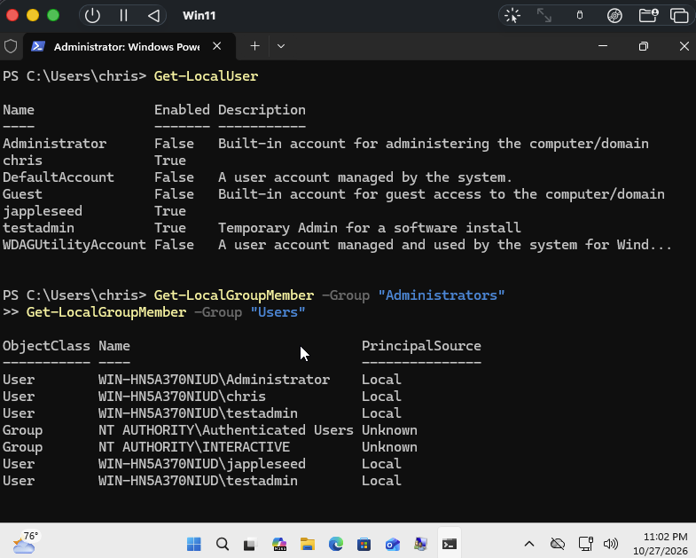

The first time I checked, `testadmin` wasn't in Administrators. I'd closed the window without hitting Apply.

## 2. Account lockout and unlock

> **Ticket:** Accounts should lock after too many wrong passwords so nobody can just keep guessing. Later that day: "John is locked out and can't sign in."

First the policy. I set it to lock after five wrong passwords. The 10-minute lockout was already the default:

```powershell
net accounts /lockoutthreshold:5
net accounts
```

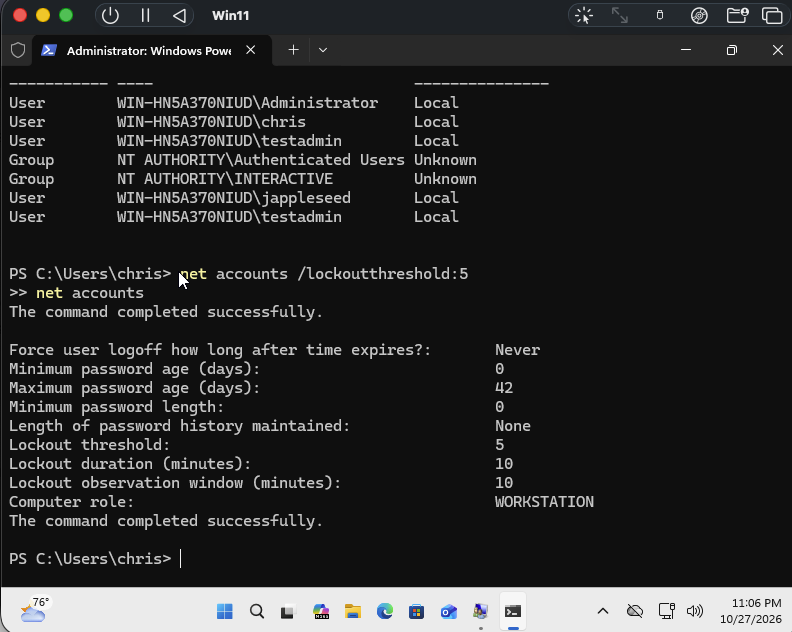

Then I played the part of John and typed the wrong password on purpose. Windows started slowing down each attempt, and then it locked him out.

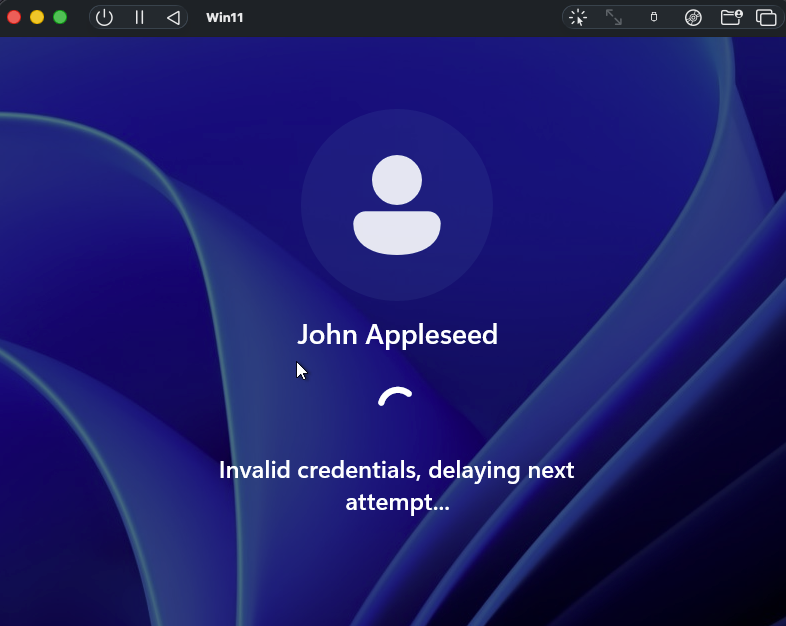


To work the ticket, I confirmed the lock from the command line, unlocked him in Local Users and Groups, and checked again:

```powershell
net user jappleseed
```

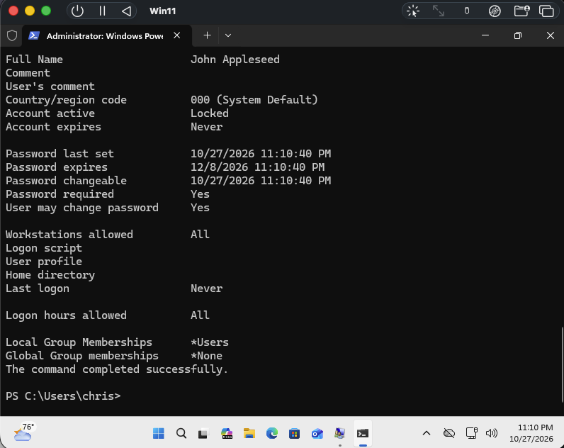

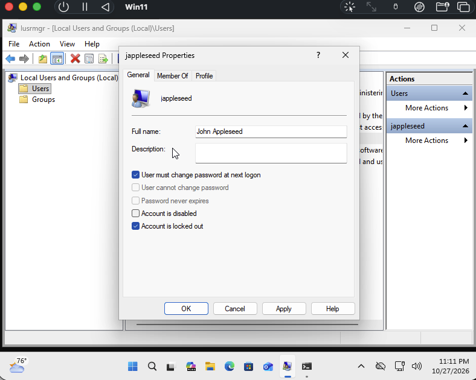

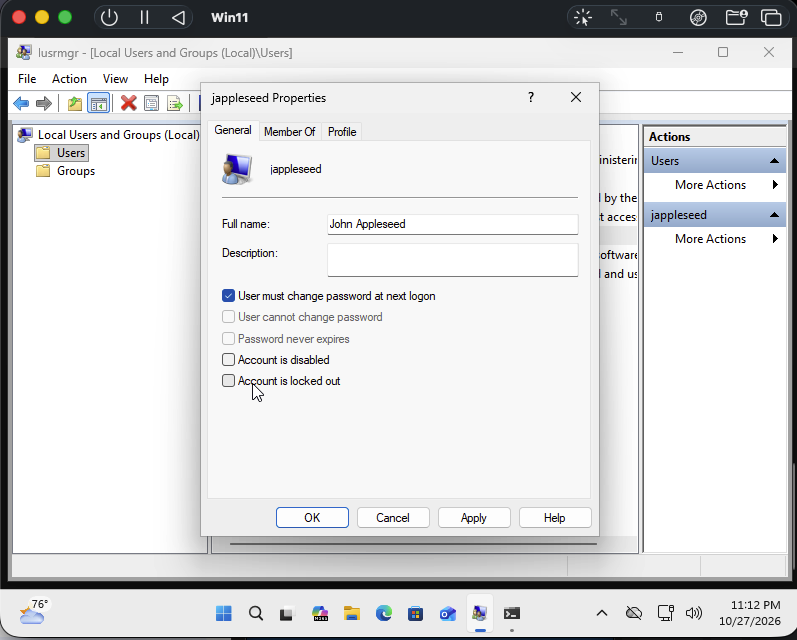

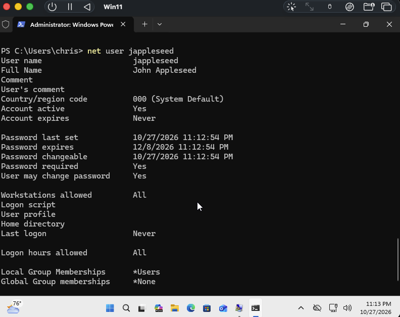

## 3. Security log

> **Ticket:** "Did John lock himself out, or is someone trying to get into his account?"

That's what the security log is for (Event Viewer > Windows Logs > Security). The two event IDs I looked at:

| Event ID | What it means |
| --- | --- |
| 4625 | An account failed to log on (one for every wrong password) |
| 4740 | A user account was locked out |

In my case it was a string of 4625s followed by a 4740, which lines up with what I did. On a real ticket I'd look at the timestamps and where the failed sign-ins came from. If it's a few failed tries in the morning from John's own computer, it's probably John. If there are dozens overnight from a computer I don't recognize, I'd escalate it.

In the 4625 screenshot the Subject shows SYSTEM, which is normal for a sign-in at the lock screen. Logon Type 2 means someone was at the keyboard, and the account that failed (jappleseed) is further down in the event. On a company domain the 4740 would show up on the domain controller, not the user's PC.

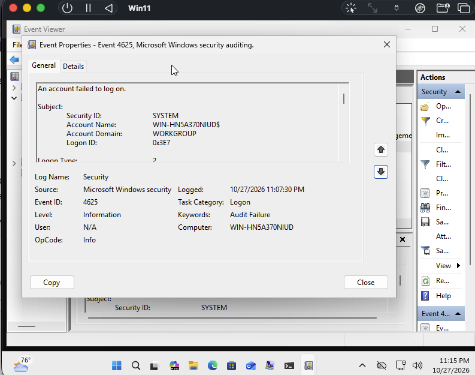

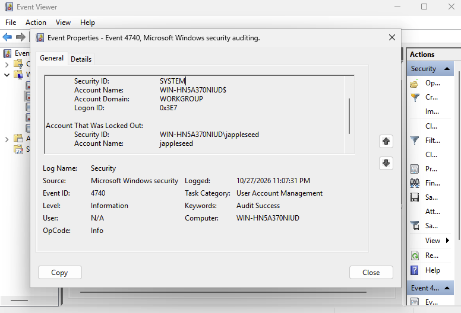

## 4. Team folder permissions (NTFS)

> **Ticket:** "The Projects team needs their own folder. Team members should be able to create and edit files. Everyone else should only be able to read them."

I made a `Projects` group, added John to it, and created the folder:

```powershell
New-LocalGroup -Name "Projects" -Description "Projects team"
Add-LocalGroupMember -Group "Projects" -Member "jappleseed"
New-Item -Path "C:\Shares\Projects" -ItemType Directory
```

Here's what the permissions looked like before I touched anything. Every line has an `(I)`, which means it was inherited from the parent folder. The one that jumped out at me was `Authenticated Users:(M)`. Anyone who could sign in to this PC could already edit files in here, which is what the ticket is asking me to fix.

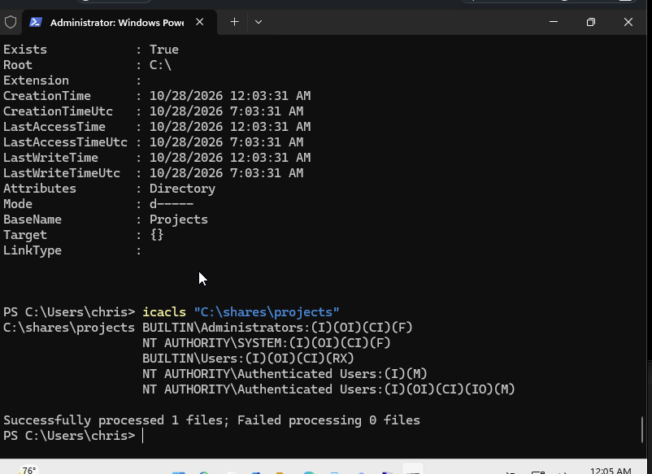

So I gave out the four permissions I actually wanted, then turned off inheritance so nothing else could sneak in from the parent folder:

```powershell
icacls "C:\Shares\Projects" /grant "Administrators:(OI)(CI)F" "SYSTEM:(OI)(CI)F" "Projects:(OI)(CI)M" "Users:(OI)(CI)RX"
icacls "C:\Shares\Projects" /inheritance:r
```

| Who | Permission | What they can do |
| --- | --- | --- |
| Administrators and SYSTEM | F | Everything (full control) |
| Projects | M | Create, edit, and delete files |
| Users | RX | Open and read only |

The `(OI)(CI)` part makes each permission carry down to every file and subfolder inside.

And after (the bottom half of this screenshot). No more `(I)`, and Authenticated Users is gone. The top half is my first try that failed, more on that below:

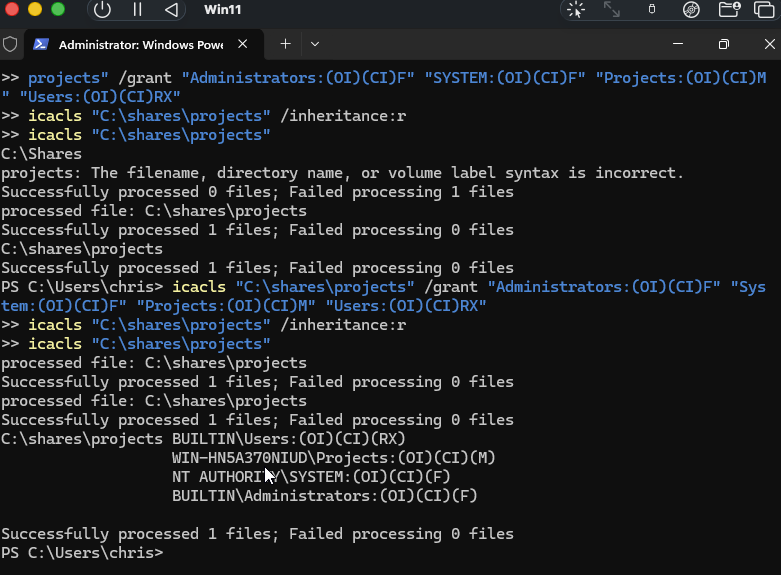

### Testing it

To test it, I made a regular user, Mary Smith, who isn't in Projects, and tried it as both people.

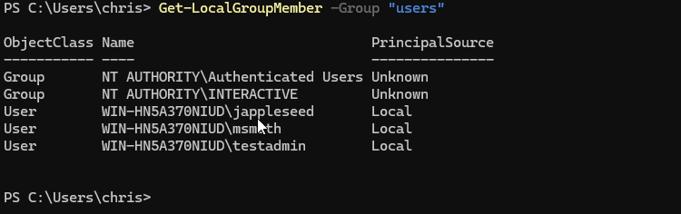

John made a new file with no problem:

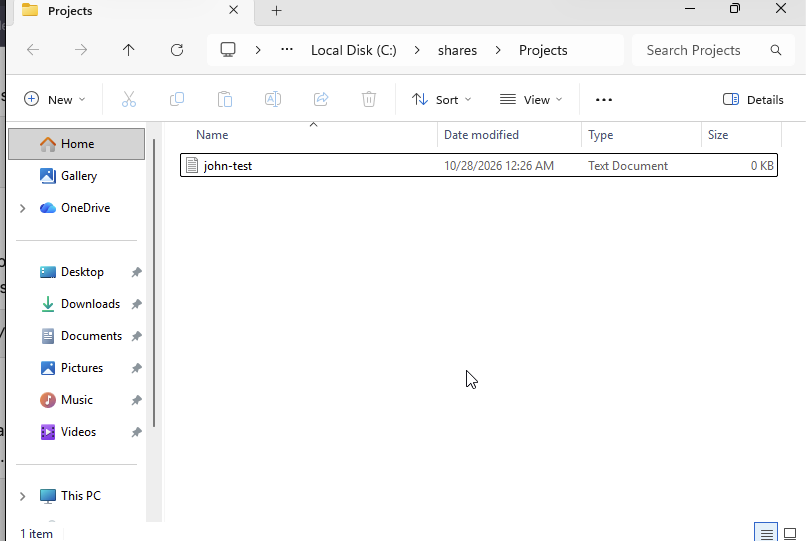

Then I signed in as Mary. She could open John's file and read it, but she couldn't create anything new or save changes:

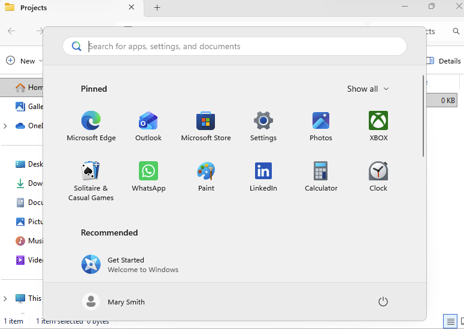

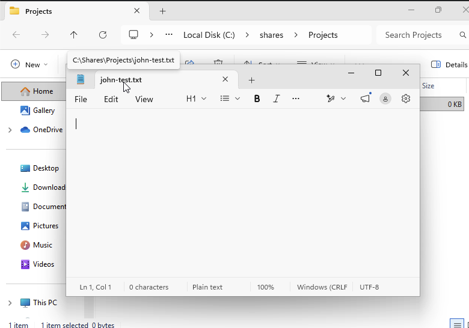

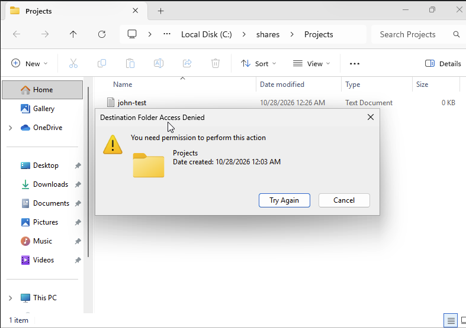

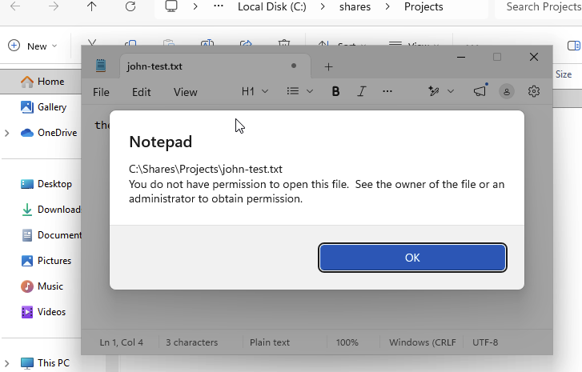

Notepad says she doesn't have permission to open the file, but she'd already opened it. It was the save that got blocked. Users read me error messages like this word for word all the time, so I try to check what actually failed.

I only tested this on the PC itself. If the folder were shared over the network, share permissions would also apply, and the more restrictive of the two wins.

### Where I messed up

My first try at the `/grant` line failed because I hit Enter in the middle of the folder path, but the `/inheritance:r` line right after it still ran. That left the folder with no permissions at all for a minute. I could still fix it because I was running as an administrator, and admins can always take ownership and reset permissions. On a real file server that same mistake could lock a whole team out of their files, so now I always grant first and remove inheritance second.

## 5. Onboarding new hires from a CSV

> **Ticket:** "Six new hires start Monday, three in Sales and three in Projects. Set up their accounts, put them in the right groups, and make them pick their own password when they first sign in."

I could have done this by hand, but that's six people times four steps each, and it's easy to skip a step on person number five. So I wrote a script.

The list of new hires lives in a CSV file ([scripts/newhires.csv](scripts/newhires.csv)). I put Mary on the list on purpose since she already exists, because I wanted to see the script skip her instead of erroring out. Since it skips anyone who already exists, she didn't get added to Projects, which kept my permissions test from section 4 intact.

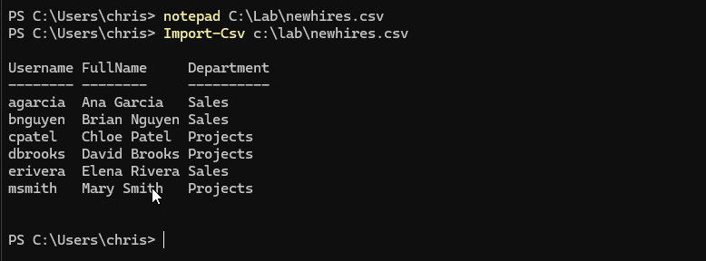

To build the script ([scripts/newhires.ps1](scripts/newhires.ps1)), I started with the steps I'd do by hand for one person, swapped the names for whatever's in each row of the CSV, and wrapped it all in a loop:

```powershell
# Create local user accounts in bulk from a CSV file
$csv = Import-Csv -Path "C:\lab\newhires.csv"
$pw = Read-Host -AsSecureString -Prompt "temporary password"

foreach ($row in $csv) {
    if (Get-LocalUser -Name $row.username -erroraction silentlycontinue) {
        Write-Host "Skip: $($row.username) already exists" -ForegroundColor Yellow
        continue
    }
    New-Localuser -Name $row.username -fullname $row.fullname -description $row.department -password $pw | Out-Null
    Add-LocalGroupmember -Group "Users" -Member $row.username
    Add-LocalGroupmember -Group $row.department -Member $row.username
    net user $row.username /logonpasswordchg:yes | Out-Null
    Write-Host "Created: $($row.username) in $($row.department)" -foregroundcolor green
}
```

A few things about how it works:

- `Import-Csv` reads each row of the CSV as a record, so I can grab `$row.username`, `$row.fullname`, and `$row.department`. PowerShell doesn't care about capitalization, so those match the CSV headers either way.
- It asks for the temporary password once, hides it as you type, and never saves it anywhere.
- The `if` check skips anyone who already has an account. That means I can run it twice without breaking anything.
- The Department column doubles as the group name. If a Finance team shows up later, I just add those rows to the CSV and make a Finance group, without touching the script.
- `New-LocalUser` doesn't have a "make them change their password" option, so I used the older `net user` command for that part.

I made the `Sales` group first, then ran it. Windows blocks scripts by default, so I allowed them for that one PowerShell window only:

```powershell
New-LocalGroup -Name "Sales" -Description "Sales team"
Set-ExecutionPolicy -Scope Process -ExecutionPolicy Bypass
C:\Lab\newhires.ps1
```

Five created, one skipped:

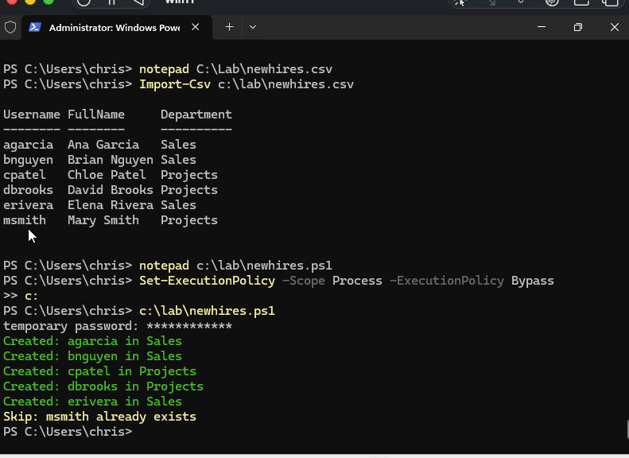

Then I checked the accounts and both groups, and ran the script a second time just to prove it would skip everyone:

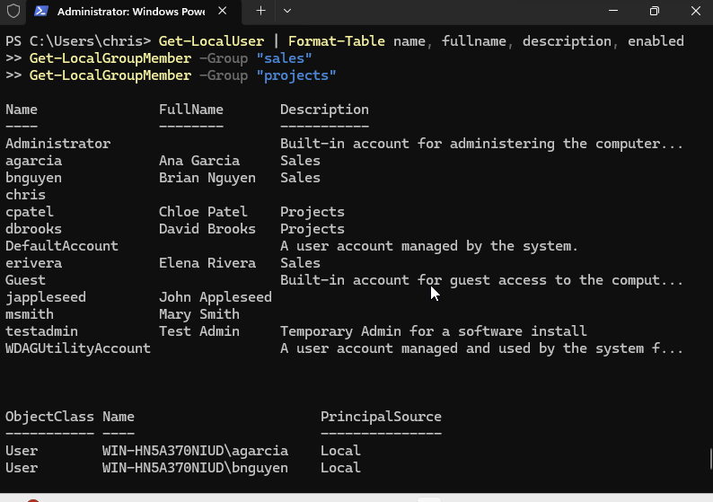

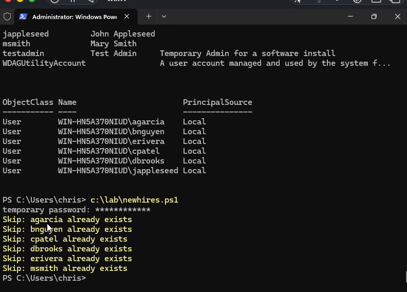

PowerShell printed both groups in one table since I ran the two commands together. The first three are Sales and the last three are Projects.

And when Ana Garcia signs in for the first time, Windows makes her pick a new password:

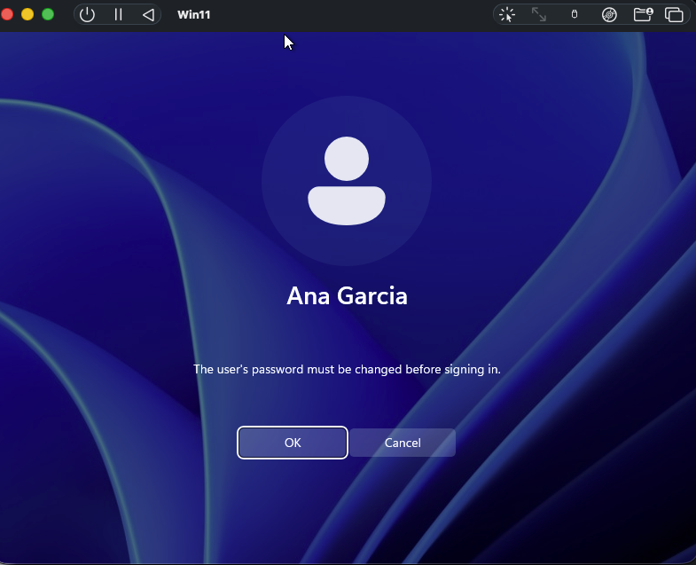

At a company these accounts would live in Active Directory instead of on one PC, so the script would use `New-ADUser` instead of `New-LocalUser`. The loop itself would stay pretty much the same. If I took this further, I'd also have it check that the group exists first and log anything that fails, instead of printing Created no matter what.

## What this lab covers

Local users and groups, temporary admin access, account lockout policy, unlocking accounts, the Windows security log (events 4625 and 4740), NTFS permissions with icacls, permission inheritance, group-based access, testing access as different users, and PowerShell scripting for onboarding.
